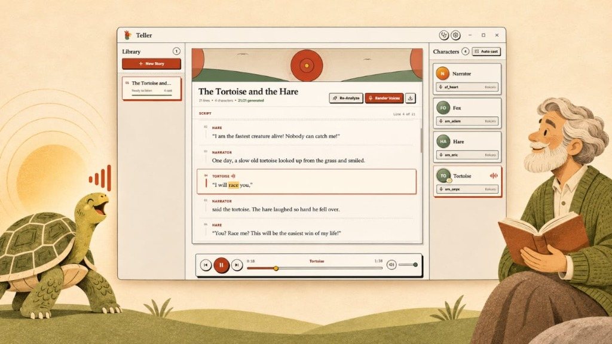

<div align="center">


# Teller

**Transform plain-text stories, books, and scripts into multi-voice audio dramas.**

Teller parses narration and dialogue, maintains a persistent character cast, assigns distinct voices, synthesizes speech ahead of playback, and exports stitched master audiobooks.

[](https://microsoft.com/windows)
[](pyproject.toml)
[](LICENSE)
[](desktop/src-tauri)
[](desktop/package.json)
[](pyproject.toml)
[](docs/ARCHITECTURE.md#5-provider-extension-system)
[](docs/ARCHITECTURE.md#5-provider-extension-system)

</div>

---

## Overview

Teller turns any story into a full-cast performance. Whether running locally or using cloud models, Teller identifies characters, extracts dialogue, attributes speech to individual voices, and plays back the story with word-by-word synchronized karaoke highlighting.

---

## Screenshots & Demo

### Stage Performance

*Synchronized speech playback, dialogue stream, live audio transport, and cast character management.*

### Video Demo
<video src="docs/images/Teller_Full_Uncropped.mp4" controls="controls" width="100%"></video>

> Download or watch the full resolution demo: [Teller_Full_Uncropped.mp4](docs/images/Teller_Full_Uncropped.mp4)

---

## Quick Start

### Windows 1-Click Launch

On Windows, run the provided launch script from the project root:

```cmd
start.bat
```

- When running in a source checkout with Node.js and Rust installed, `start.bat` launches Teller in live development mode with hot-reloading.
- To launch the compiled release executable instead, run:

```cmd
start.bat --release
```

### Pre-Built Binaries

Release installers and standalone executables are output to:
- Standalone Executable: `desktop/src-tauri/target/release/teller-desktop.exe`
- Windows Installer: `desktop/src-tauri/target/release/bundle/nsis/Teller_0.1.0_x64-setup.exe`

---

## Key Features

- **Accurate Dialogue Attribution**: Separates narrator prose from character dialogue without modifying or rewriting original text.
- **Multiple LLM Providers**:
  - **Groq Cloud AI**: Fast dialogue analysis powered by models like `openai/gpt-oss-120b`, `qwen/qwen3.8-27b`, and `openai/gpt-oss-20b`.
  - **Google Gemini**: Cloud analysis and native multi-speaker voice synthesis.
  - **Ollama**: Local, private LLM execution without external network requests.
  - **Rule-Based Engine**: Built-in regex and heuristic attribution requiring no API keys.
- **Voice Synthesis Options**:
  - **Kokoro ONNX**: High-quality offline neural TTS using a lightweight INT8 model (~140 MB).
  - **ElevenLabs**: Expressive cloud voices with automatic rate-limit protection and backoff retries.
  - **Gemini TTS**: High-speed speech synthesis matching your Google AI configuration.
- **Master Audio Export**: Stitches rendered dialogue segments with natural inter-speaker pauses into a single 16-bit PCM WAV audiobook.
- **Deterministic Audio Cache**: Every line of speech is cached by exact text, voice parameters, emotion, and speed, preventing duplicate API costs.
- **Secure Key Management**: API credentials are saved directly in your operating system credential store (Windows Credential Manager, macOS Keychain, Linux Secret Service).
- **Paper Theatre Interface**: Custom Windows titlebar controls, responsive rails, and clean aesthetic typography.

---

## Installation & Setup

### Prerequisites

- **Python**: 3.10 through 3.13
- **Node.js**: 18 or higher (for frontend development)
- **Rust**: Latest stable toolchain (for Tauri desktop binary)
- **Audio Device**: Standard system audio output

### 1. Clone the Repository

```bash
git clone https://github.com/boldbug1/teller.git
cd teller
```

### 2. Python Environment Setup

Create and activate a virtual environment:

```bash
# On Windows
python -m venv .venv
.venv\Scripts\activate

# On macOS / Linux
python3 -m venv .venv
source .venv/bin/activate
```

Install package dependencies:

```bash
# Full installation (all cloud and local providers)
pip install -e ".[all]"

# Or choose specific profiles:
pip install -e ".[cloud]"   # Groq, Gemini, ElevenLabs
pip install -e ".[local]"   # Kokoro ONNX offline TTS
```

### 3. Provider Configuration

Configure API keys and model preferences:

```bash
# Interactive setup wizard
teller setup

# Validate configuration and connectivity
teller doctor
```

Alternatively, set environment variables:
- `GROQ_API_KEY`: API key for Groq Cloud.
- `GEMINI_API_KEY`: API key for Google Gemini.
- `ELEVENLABS_API_KEY`: API key for ElevenLabs.

### 4. Desktop Frontend Setup

```bash
cd desktop
npm install
npm run tauri dev
```

---

## Command-Line Interface (CLI)

Teller includes a command-line interface for headless environments and automated workflows:

```bash
# Analyze story text and detect characters
teller analyze path/to/story.txt

# Synthesize speech for all dialogue lines
teller render path/to/story.txt

# Play story audio through the system output
teller play path/to/story.txt

# Export a master WAV audiobook
teller export my-story-id -o output_audiobook.wav

# Inspect the cast and set character voices
teller cast stories/my-story-id
teller voices list
teller voices set stories/my-story-id "Character Name" voice_id
```

---

## Project Structure

```text
teller/
├── src/teller/               # Core Python library and engine
│   ├── api.py                # FastAPI REST and WebSocket API
│   ├── tagger.py             # Dialogue attribution and chunking
│   ├── pipeline.py           # Audio rendering and synthesis pipeline
│   ├── characters.py         # Character registry and voice assignment
│   ├── providers/            # LLM and TTS provider adapters
│   │   ├── llm_groq.py       # Groq client
│   │   ├── llm_gemini.py     # Gemini client
│   │   ├── llm_ollama.py     # Ollama local client
│   │   ├── tts_kokoro.py     # Kokoro ONNX engine
│   │   └── tts_elevenlabs.py # ElevenLabs engine
│   ├── audio_export.py       # Audio concatenation and WAV stitching
│   └── server.py             # HTTP server entrypoint for the sidecar
├── desktop/                  # Desktop application
│   ├── src/                  # React 19 + TypeScript source
│   │   ├── components/       # UI components (Header, StoryScene, CastRail)
│   │   ├── styles/           # CSS design system (paper-theatre.css)
│   │   └── audio/            # HTML5/WebAudio playback engine
│   ├── src-tauri/            # Tauri 2 Rust harness and configuration
│   └── public/               # Application icons and vector branding
├── docs/                     # Project documentation and visual assets
│   ├── images/               # Showcase screenshot, video demo, and brand assets
│   └── ARCHITECTURE.md       # Detailed technical architecture guide
├── stories/                  # Local story library and audio cache
├── scripts/                  # Build scripts for sidecar and desktop app
├── CONTRIBUTING.md           # Contribution guidelines
├── AGENTS.md                 # System instructions for AI coding agents
├── pyproject.toml            # Python packaging and dependencies
└── start.bat                 # Windows one-click desktop launcher
```

---

## Storage & Audio Cache

Stories are saved locally under `stories/<slug>-<hash>/`:

```text
stories/example-story-0abd4a94/
├── story.txt              # Original untouched source text
├── manifest.json          # Story metadata and unique identifier
├── analysis.json          # Character list and dialogue assignments
├── characters.json        # Character voice mapping mirror
├── segments.json          # Timestamped segment list
└── audio/                 # Exact-phrase deterministic audio cache
    └── <hash>.wav         # Synthesized speech cache files
```

The audio cache key is a SHA-256 hash derived from the exact segment text, TTS provider, model, voice ID, emotion style, speed, and language. Re-playing, re-opening, or re-rendering never re-synthesizes unchanged lines.

---

## Documentation Links

- [Architecture Guide](docs/ARCHITECTURE.md): Technical deep dive into sidecar communication, audio streaming, and data structures.
- [Contributing Guide](CONTRIBUTING.md): Environment setup, coding conventions, and pull request workflow.
- [Agent Guidelines](AGENTS.md): Architectural rules, contracts, and invariants for AI agents working in this repository.

---

## Responsible Use & License

Generated voices are synthetic. Always disclose the synthetic nature of generated audio where required, and ensure you possess appropriate rights to the texts and voices you process.

Teller is released under the [MIT License](LICENSE). Optional model weights and third-party libraries maintain their respective licenses.
