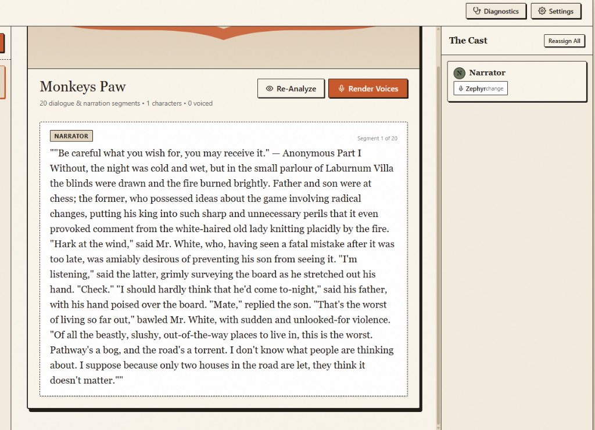
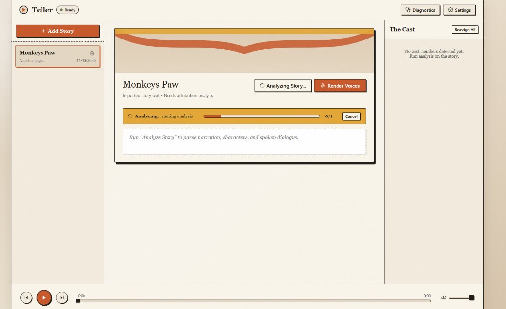

# Teller

> **Transform plain-text stories and books into multi-voice audio dramas.**  
> Teller parses narration and dialogue, maintains a persistent character cast, assigns distinct voices, synthesizes speech ahead of playback, and provides one-click master audio downloads.

---

## ⚡ Quick Start: 1-Click Desktop Launch

On Windows, simply run:

```cmd
start.bat
```

> **That's it!** In a source checkout with Node.js and Rust installed, `start.bat` launches the latest code through Tauri development mode. Use `start.bat --release` to launch the existing packaged binary instead.

### What you can do right away:
1. **Import Stories**: Click **+ Add Story** to paste text or import `.txt`, `.md`, `.pdf`, or `.docx` documents with automatic title detection.
2. **Analyze & Cast**: Click **Analyze Story** to parse characters and dialogue using **Groq** (recommended, sub-second Llama 3.3), **Gemini**, **Ollama** (local), or the built-in offline **Rule-Based Engine**.
3. **Assign Voices**: Customize character voices in **The Cast** rail using **Kokoro** (100% offline), **ElevenLabs**, or **Gemini**.
4. **Render Voices**: Synthesize speech with live progress tracking and zero duplicate API calls (deterministic cache).
5. **Download Master Audio**: Click **Download Audio** on the stage to save a clean, stitched `.wav` audiobook to your computer.

---

## 🎭 Screenshots

<div align="center">
  
  <p><em>The Paper Theatre Studio: multi-voice dialogue tagging, character cast rail, and synchronized audio playback.</em></p>
</div>

<div align="center">
  
  <p><em>Real-time analysis progress, background voice synthesis, and one-click audio export.</em></p>
</div>

---

## 🌟 Key Features

- **Multi-Voice Dialogue Attribution**: Accurately separates narrator passages from character dialogue without rewriting your story.
- **Ultra-Fast LLM Providers**:
  - **Groq** *(Llama 3.3 70B & 8B)*: Instantaneous, sub-second dialogue analysis with high accuracy.
  - **Google Gemini** *(Flash / Pro)*: Fast cloud analysis and native multi-speaker TTS.
  - **Ollama**: 100% private, local LLM analysis (e.g. `qwen2.5`, `llama3.2`).
  - **Built-in Rule Engine**: Deterministic regex/heuristic fallback requiring zero API keys or external services.
- **Voice Synthesis Options**:
  - **Kokoro ONNX**: Free, lightweight offline neural TTS (~140MB INT8 model).
  - **ElevenLabs**: Premium speech synthesis with automatic rate-limit clamping (429 concurrency prevention) and exponential backoff retry.
  - **Gemini TTS**: Cloud voices matching your Gemini key.
- **Full Story Audio Download & Export**: Combine hundreds of rendered dialogue segments with natural inter-speaker pauses into a master 16-bit PCM WAV audiobook via desktop UI or CLI.
- **Paper Theatre Desktop UI**: Built with Tauri 2, React 19, TypeScript, masked secure API key storage in the OS credential manager, and Web Audio streaming playback.

---

## 🛠️ CLI Quick Reference

Teller can also run entirely as a headless command-line tool:

```console
# 1. Analyze and tag character dialogue
teller analyze path/to/story.txt

# 2. Synthesize missing speech segments
teller render path/to/story.txt

# 3. Play through system audio output
teller play path/to/story.txt

# 4. Export full stitched audio story to a single WAV file
teller export monkeys-paw-9f742a64 -o my_audiobook.wav

# 5. Check character cast and customize voices
teller cast stories/my-story-ab12cd34
teller voices list
teller voices set stories/my-story-ab12cd34 "Mr. White" am_adam
```

---

## 📦 Requirements & Manual Setup

If you want to run from source or build the application manually:

- **Python**: 3.10 through 3.13
- **Node.js**: v18+ (for desktop frontend)
- **Rust**: Latest stable (for Tauri desktop binary)
- **Audio Output**: Any standard system audio device

### Manual Python Installation

```console
# Clone repository
git clone https://github.com/boldbug1/teller.git
cd teller

# Create and activate virtual environment
python -m venv .venv
.venv\Scripts\activate

# Install with all providers
pip install -e ".[all]"
```

For cloud-only or local-only setups:
```console
pip install -e ".[cloud]"   # Gemini, Groq, ElevenLabs
pip install -e ".[local]"   # Kokoro ONNX, sounddevice
```

### Provider Configuration

Run the interactive setup assistant or doctor check:

```console
# Configure providers and keys
teller setup

# Validate configuration and network connectivity
teller doctor
```

API keys are securely persisted in the operating system credential manager (Windows Credential Manager / macOS Keychain / Linux SecretService). You can also provide keys via environment variables:
- `GROQ_API_KEY`
- `GEMINI_API_KEY`
- `ELEVENLABS_API_KEY`

---

## 🖥️ Desktop Application Development

Teller's desktop application uses Tauri 2 and React 19:

```console
# 1. Install frontend dependencies
cd desktop
npm install

# 2. Run in development mode with hot-reloading
npm run tauri dev

# 3. Run frontend unit tests
npm test

# 4. Build self-contained release executable
npm run build
npm run tauri build -- --no-bundle
```

To recompile the Python engine sidecar:
```powershell
.\scripts\build_sidecar.ps1
```

---

## 📁 Storage Architecture

Every imported story is stored under `stories/<title>-<source-hash>/`:

```text
story.txt              # Original untouched source text
manifest.json          # Story metadata and unique ID
analysis.json          # Character list and dialogue assignments (source of truth)
characters.json        # Character voice mapping mirror
segments.json          # Segment timestamps and text mirror
audio/<cache-hash>.wav # Exact-phrase deterministic WAV audio cache
```

- **Deterministic Cache**: Audio cache keys hash the exact text, provider, model, voice ID, emotion style, speed, and language.
- Re-playing or re-rendering never incurs duplicate API charges for identical segments.

---

## 📜 Responsible Use & License

Generated voices are synthetic. Disclose that fact to listeners where appropriate, and only process stories and voices you have permission to use.

Teller is released under the **MIT License**. Optional models and runtimes retain their respective licenses.
