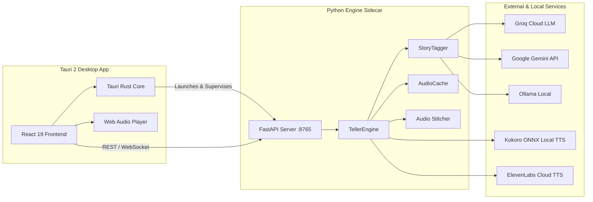

# Teller Architecture Guide

This document provides a comprehensive technical overview of Teller's dual-process system architecture, data models, audio pipeline, and provider interfaces.

---

## 1. System Overview

Teller is organized into two primary processes:

1. **Frontend / Desktop Shell**: A native desktop application built with Tauri 2, React 19, and TypeScript.
2. **Backend Engine**: A Python process exposing a FastAPI REST and WebSocket server, packaged as an embedded sidecar binary (`teller-sidecar`).



---

## 2. Process Lifecycle & IPC

### Startup Sequence

1. When the user launches `teller-desktop.exe`, Tauri's Rust process initiates.
2. In `desktop/src-tauri/src/lib.rs`, Tauri locates and spawns the external sidecar binary (`teller-sidecar-x86_64-pc-windows-msvc.exe`) using a dynamic port or default port `8765`.
3. The React frontend boots inside the webview and polls `GET /v1/health` until the sidecar reports status `healthy`.
4. The frontend queries `GET /v1/setup/status` to determine if keys are stored in the OS credential manager and whether local models (such as Kokoro INT8) are downloaded.

### Graceful Termination

- When the desktop window is closed, Tauri terminates the child sidecar process cleanly to ensure no orphaned Python background tasks remain.

---

## 3. End-to-End Pipeline

The transformation from raw text to playable audio proceeds in six distinct phases:

### Phase 1: Ingestion (`src/teller/document.py`)
- Reads raw input files (`.txt`, `.md`, `.markdown`, `.pdf`, `.docx`).
- Extracts plain text, normalizes line breaks, and cleans typographical artifacts (smart quotes, em dashes, non-breaking spaces).
- Generates a URL-safe story slug and computes a content-derived hash for folder isolation (`stories/<slug>-<hash>/`).

### Phase 2: Segmentation & Chunking (`src/teller/chunker.py`)
- Splits source text into contiguous `SourceUnit` records:
  - `kind="dialogue"`: Text enclosed in quotation marks (`"..."`, `“...”`, `‘...’`).
  - `kind="narration"`: All intervening text between dialogue spans.
- Assembles units into `StoryChunk` batches constrained by `max_chunk_chars` (default 8,000 characters).
- Adds overlapping `context_before` and `context_after` windows to each chunk to give the LLM surrounding narrative context for speaker attribution.

### Phase 3: Dialogue Attribution (`src/teller/tagger.py`)
- Sends chunk units to the configured LLM provider alongside `TaggingResult.model_json_schema()`.
- The LLM attributes each unit to either:
  - An existing character ID.
  - A new character reference (e.g. `new_hare` or `hare`), accompanied by name, gender, age, and personality traits.
  - The default `"narrator"` for narration.
- `_validate_result` verifies that every spoken unit in the chunk is accounted for exactly once.
- `CharacterRegistry` (`src/teller/characters.py`) resolves character aliases across consecutive chunks and merges character metadata.

### Phase 4: Voice Assignment (`src/teller/voices.py`)
- Inspects the character list and pairs each character with a distinct voice ID from the active TTS provider.
- Matching criteria prioritize:
  - Gender alignment (male, female, neutral).
  - Trait hints (e.g., elderly, youthful, authoritative).
  - Narrator defaults (warm, neutral pacing).
- Users can manually override voice assignments at any time via the Cast rail.

### Phase 5: Audio Synthesis & Caching (`src/teller/pipeline.py`)
- Iterates over all dialogue and narration segments.
- For each segment, calculates a deterministic SHA-256 cache key:
  ```
  key = sha256(text + provider + model + voice_id + emotion + speed + language)
  ```
- If `audio/<key>.wav` exists on disk, synthesis is skipped immediately.
- If missing, the segment is dispatched to the active TTS provider (`Kokoro`, `ElevenLabs`, or `Gemini`).
- For rate-limited APIs (ElevenLabs), synthesis runs under a concurrency semaphore with exponential backoff on HTTP 429.

### Phase 6: Playback & Master Audio Export (`src/teller/audio_export.py`)
- **Interactive Playback**: The frontend streams individual segment audio clips sequentially via Web Audio, calculating word timing offsets for karaoke-style word illumination.
- **Audiobook Download**: The backend stitches all WAV segments into a single 16-bit PCM master file, inserting configurable inter-speaker silence pauses (`speaker_pause_ms`, default 180ms).

---

## 4. Data Storage Layout

All project state is stored within the project's `stories/` directory:

```text
stories/<story_slug>-<hash>/
├── story.txt              # Original untouched manuscript text
├── manifest.json          # Story metadata, created timestamp, title, source hash
├── analysis.json          # Canonical source of truth: characters and segments
├── characters.json        # Fast-lookup character mirror
├── segments.json          # Fast-lookup segments mirror
└── audio/                 # Deterministic audio cache directory
    ├── 1a2b3c4d...wav     # Segment audio clip (16-bit PCM WAV)
    └── 9e8f7a6b...wav     # Segment audio clip
```

---

## 5. Provider Extension System

Teller uses protocol-based provider abstraction (`src/teller/providers/protocols.py`). To add a new provider:

### Adding an LLM Provider

1. Implement the `LLMProvider` protocol:
   ```python
   class CustomLLM:
       provider_id = "custom"

       async def generate(self, prompt: str, schema: dict[str, Any] | None = None) -> str:
           # Send prompt and schema to LLM endpoint
           # Return valid JSON string conforming to schema
           ...
   ```
2. Register the provider in `src/teller/providers/factory.py` under `create_llm()`.
3. Add the provider option to `desktop/src/components/SettingsModal.tsx`.

### Adding a TTS Provider

1. Implement the `TTSProvider` protocol:
   ```python
   class CustomTTS:
       provider_id = "custom"

       async def list_voices(self) -> list[Voice]:
           # Return available voice definitions
           ...

       async def synthesize(self, text: str, voice_id: str, ...) -> bytes:
           # Return raw 16-bit WAV bytes
           ...
   ```
2. Register the provider in `src/teller/providers/factory.py` under `create_tts()`.
3. Add voice options to `desktop/src/components/VoicePickerModal.tsx`.
